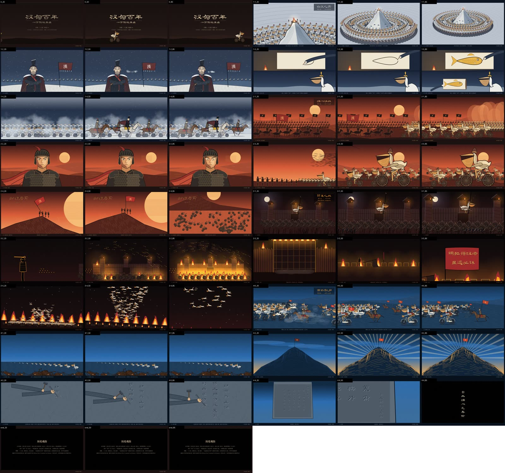

# 汉匈百年 · 十万鹈鹕来袭

历史戏仿代码动画：鹈鹕骑二八大杠，四幕：白登之围/漠北决战·封狼居胥/郅支之战/燕然勒功。

这是粗剪 v4 的源代码。画面按时间轴在画布上逐帧画出来，同一套 `renderAt(t)` 既给浏览器预览，也给无头截帧。全片 176 秒，1920×1080，三十帧。

本片属于历史戏仿。页边注标出了戏剧化的地方，不能拿来当史料引用。




## 预览

用浏览器打开 `film-v4.html`。拖动进度条可以跳到任意秒。控制台里也可以调用 `seek(62.5)`。播放键会试着同步音效。音效文件不在仓库里，需要先按下面的步骤生成，否则只有画面。

若浏览器拦截 `file://` 下的字体或音频，在仓库根目录起一个本地静态服务再打开：

```bash
python3 -m http.server 8765
```

然后访问 `http://127.0.0.1:8765/film-v4.html`。

## 渲染

不使用 Puppeteer 或 Playwright，也没有需要安装的 npm 依赖。`render-full.mjs` 启动本机 Chrome（开发者工具协议），打开 `film-v4.html?export`，调用 `seek(t)`，再把 JPEG 帧管道交给 ffmpeg。

依赖：

- Node.js 22 或更新。脚本使用全局 `fetch` 与 `WebSocket`。
- Google Chrome 或 Chromium。默认依次查找 `/usr/bin/google-chrome`、`/usr/bin/google-chrome-stable`、`/usr/bin/chromium`、`/usr/bin/chromium-browser`。其它路径用环境变量 `CHROME`。
- ffmpeg，只在编码成片、或把音效从 float32 转成 wav 时需要。
- 可选：Python 3 与 Pillow，用来拼关键帧联系表。联系表脚本写死了 `/usr/share/fonts/opentype/noto/NotoSansCJK-Regular.ttc`。

```bash
# 单帧或多帧（单位：秒）。结果在 qa/preview/
node render-full.mjs --frames 0
node render-full.mjs --frames 0,45.5,123.5

# 每个镜头 20% / 50% / 85% 处的关键帧，写入 qa/keyframes/
node render-full.mjs --keys

# 可重复性与车架数值校验，写入 qa/check.json
node render-full.mjs --check

# 无声成片，写到仓库根目录：汉匈百年_四幕粗剪_v4_无声.mp4
node render-full.mjs --video

# 关键帧、校验、成片一起做
node render-full.mjs --all

# 封面 PNG（仓库根目录的 封面_汉匈百年_1920x1080.png）
node render-full.mjs --cover

# 确认三极字体是否被页面认到
node render-full.mjs --fontcheck
```

`package.json` 里有对应的 `npm run frame`、`npm run keys`、`npm run check`、`npm run video`、`npm run render`。`npm install` 不会安装任何包。这里故意不写 `"type": "module"`，因为 `sfx.mjs` 要用 `require` 读 `shots.js`。

环境变量 `TAG` 保留旧的多版本目录习惯：页面改找 `film-${TAG}.html`，中间文件进 `qa_${TAG}/`，成片进 `${TAG}/`。本仓库只有 `film-v4.html`，平常不要设 `TAG`。

`qa/`、mp4、wav 都在 `.gitignore` 里。

### 音效草稿

`sfx.mjs` 按 `shots.js` 的事件表现算振荡器、噪声和弦模型，不用外部采样。输出是 48 kHz 单声道 float32：

```bash
node sfx.mjs
ffmpeg -y -f f32le -ar 48000 -ac 1 -i qa/sfx.f32 汉匈百年_四幕粗剪_v4_音效草稿.wav
```

预览页读取仓库根目录的这个 wav。

### 联系表

关键帧出来之后，可以用 Pillow 拼一张总览：

```bash
python3 tools/sheet.py qa docs/关键帧总览_自渲染.jpg
```

`tools/compare.py` 是更早一版的返修对比，路径仍指着 `v1` / `v2` 目录，不参与 v4 成片。

## 字体

三极曹全碑隶书简 `SJcaoquanbei.ttf`（版权三极字库）需要自己放到 `_fonts/SJcaoquanbei.ttf`。仓库不收录这个文件。商业使用需要相应授权。说明见 [`_fonts/README.md`](_fonts/README.md)。

没有这套字体时，标题会退回系统字体，截帧仍然能跑。

画面里的注释优先使用「Noto Serif CJK SC」（SIL Open Font License，例如 Debian 的 `fonts-noto-cjk`）。这个字体没有打包进仓库。系统里没有它时，浏览器会用别的中文字体顶上。

## 重造隶书笔画数据

`glyphs_lishu.js` 已经提交，日常渲染不用重跑。若要重造，需要 Make Me a Hanzi 的 `graphics.txt`（笔顺中线）。该文件在仓库根目录，派生自文鼎 PL 楷体，按 Arphic Public License 分发。

- 项目：https://github.com/skishore/makemeahanzi
- 文件：https://github.com/skishore/makemeahanzi/blob/master/graphics.txt
- 原始地址：https://raw.githubusercontent.com/skishore/makemeahanzi/master/graphics.txt

```bash
mkdir -p /tmp/mmah
curl -L -o /tmp/mmah/graphics.txt https://raw.githubusercontent.com/skishore/makemeahanzi/master/graphics.txt
python3 tools/build_lishu.py glyphs_lishu.js /tmp/mmah/graphics.txt
```

第二个参数可以省略。此时先读环境变量 `MMAH_GRAPHICS`，没有则默认 `/tmp/mmah/graphics.txt`。

```bash
MMAH_GRAPHICS=/path/to/graphics.txt python3 tools/build_lishu.py glyphs_lishu.js
```

重跑会覆盖 `glyphs_lishu.js`。许可全文在 `tools/ARPHIC_PUBLIC_LICENSE.txt`。

## 文件

| 路径 | 作用 |
| --- | --- |
| `film-v4.html` | 预览页：画布、进度条、字体与音效 |
| `kit.js` `kit2.js` `kit3.js` `kit4.js` `kit5.js` | 画布工具、骑行骨架、隶书笔画、角色与车 |
| `shots.js` | 镜头顺序、时长、音效事件。Node 音效脚本也读它 |
| `timeline.js` | `renderAt(t)` 与页边注 |
| `scenes/s0.js` `s1.js` `s2.js` `s3.js` `s4.js` `s4b.js` `s_end.js` | 各幕场景。`s4b.js` 是稽落山之战 |
| `cover.js` | 封面 |
| `glyphs_lishu.js` | 程序隶书化后的笔顺，派生自 Arphic 数据 |
| `render-full.mjs` | 无头 Chrome 逐帧截图，ffmpeg 编码 |
| `sfx.mjs` | 程序化音效，写出 `qa/sfx.f32` |
| `tools/build_lishu.py` | 从 `graphics.txt` 生成 `glyphs_lishu.js` |
| `tools/sheet.py` | 关键帧联系表 |
| `tools/compare.py` | 旧版返修对比，不用于 v4 |
| `tools/ARPHIC_PUBLIC_LICENSE.txt` | 文鼎公众授权书全文 |
| `THIRD_PARTY_NOTICES.md` | 方法来源的 MIT 声明，以及 Arphic 许可 |
| `docs/镜头时长表_v4.md` | 镜头表 |
| `docs/README_v4.md` | v4 相对上一剪改了哪些画面 |
| `docs/cover.jpg` `docs/keyframes.jpg` | 封面与关键帧 |
| `_fonts/README.md` | 自备字体的说明 |

## 授权与权利

代码以 MIT 许可发布，版权所有 © 2026 vsu7777，全文见 `LICENSE`。

下列内容不在这份 MIT 授予的范围内：

- 成片画面、`docs/cover.jpg`、`docs/keyframes.jpg`，以及角色与构图的美术权利，由作者保留。
- `glyphs_lishu.js` 中的笔顺数据仍适用 Arphic Public License（文鼎公众授权书）。全文见 `tools/ARPHIC_PUBLIC_LICENSE.txt`，说明见 `THIRD_PARTY_NOTICES.md`。

## 致谢

做法受两个 MIT 项目启发：共用一副骑行骨架、每镜一个场景文件、纯 `renderAt(t)`、无头浏览器逐帧截图。两个项目的成片、画面、音乐与笑点都没有用进本片，权利仍归原作者。许可声明全文在 `THIRD_PARTY_NOTICES.md`。

- The Pelican Test，Royce Bella：https://github.com/RoyceBella-commits/The-Pelican-Test
- meme67-art-history，Tunai-0511：https://github.com/Tunai-0511/meme67-art-history

笔顺数据来自 Make Me a Hanzi（Shaunak Kishore）：https://github.com/skishore/makemeahanzi 。`graphics.txt` 派生自 Arphic PL KaitiM GB 与 Arphic PL UKai。`glyphs_lishu.js` 只抽取了其中若干字的 medians，再做隶书化变形，不是原碑描摹。
